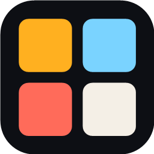
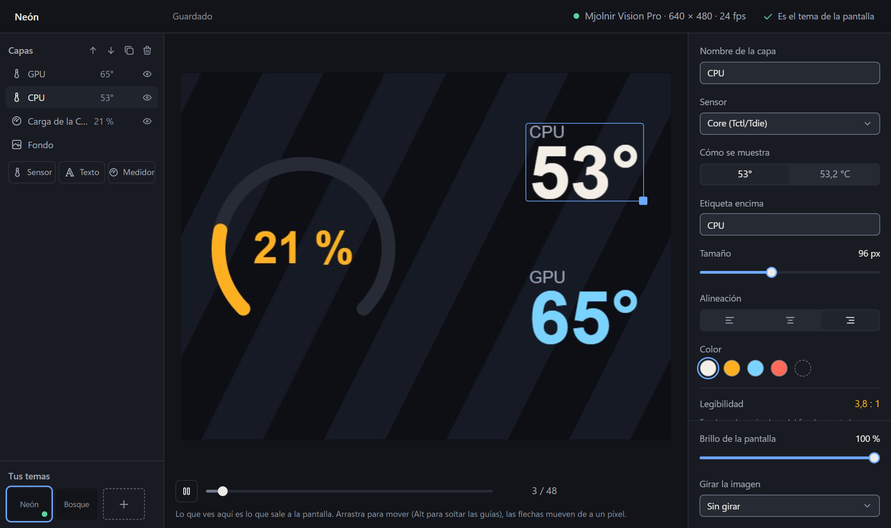

<p align="center"></p>

<h1 align="center">Vitral</h1>

<p align="center">
  An open-source replacement for Thermalright's TRCC on Windows.<br>
  Keeps your AIO or cooler screen on and lets you design what it shows.
</p>

<p align="center">
  <a href="https://github.com/Ntropicsam/vitral/releases/latest">Download</a> ·
  <a href="README.es.md">Leer en español</a> ·
  <a href="CONTRIBUTING.md">Contribute</a>
</p>

---

**Vitral is a free, open-source alternative to TRCC (Thermalright Control Center)
for the LCD screens on Thermalright "Vision" AIO liquid coolers and air coolers,
such as the Mjolnir Vision 360.** These screens only show an image while TRCC is
open and go dark a couple of seconds after you close it. Vitral talks to the screen
directly over USB, lives in the Windows system tray and keeps it on. It comes with
a theme editor so you can put a GIF, a video or a photo behind your CPU and GPU
temperatures.

<p align="center"></p>

## Features

- **Always on.** The screen keeps its image with the editor closed and starts with
  Windows if you want it to.
- **Your own themes.** Images, GIFs and videos as backgrounds, with sensor values,
  text and ring or bar gauges on top. Any sensor LibreHardwareMonitor can read is
  available.
- **Frames for the background.** Start a theme from its background: Vitral
  suggests layouts that fit it without stretching, like a video on the left with a
  strip of values beside it, or a centered frame with rounded corners.
- **Sensors easy to find.** Grouped by device (CPU, GPU, motherboard…) and type,
  with a search box and a unified average and maximum for every series, like all
  CPU cores.
- **Eight fonts.** Pick one for each value and another for its label, and place
  the label above, below or beside it.
- **Readable numbers.** The editor measures the contrast of every value against the
  brightest frame of the background and warns you when it is hard to read, with a
  one-click backdrop to fix it.
- **Brings your TRCC themes.** Import any TRCC `Theme.zt` as it is.
- **Light on resources.** A still theme is only redrawn when a value changes. With no
  screen connected nothing is drawn, fullscreen games drop it to one frame per
  second, and with the editor closed Windows runs it in efficiency mode.
- **Updates itself.** New versions download in the background and install the next
  time Vitral starts.

## Vitral and TRCC

| | TRCC | Vitral |
|---|---|---|
| Source code | Closed | Open (GPL-3.0) |
| Screen after closing the window | Goes dark | Stays on (tray app) |
| Runs as administrator | Yes, at every startup | No; only a small read-only sensor service does |
| Works with TRCC themes | Yes | Yes (imports `Theme.zt`) |

## Install

1. Download `Vitral-win-Setup.exe` from the [latest release](https://github.com/Ntropicsam/vitral/releases/latest) and run it.
2. Close TRCC from its tray icon: only one program can use the screen at a time. If
   TRCC starts with Windows, Vitral's settings can turn that off.
3. To show the CPU temperature, click **Enable it** in the editor, or the
   notification. Windows asks for permission once; see [Security](#security).
4. Turn on **Start with Windows** in the settings (the gear in the editor) if you
   want it. Clicking the tray icon opens the editor.

Requires Windows 10 or 11 (64-bit) and WebView2, which ships with Windows 11. No
Zadig or extra drivers: Windows already binds WinUSB to the screen.

The interface is in English and Spanish and follows the Windows language; you can
change it in the settings.

## Supported screens

Vitral speaks to USB screens with the id `87AD:70DB` (ChiZhu). Many models share it:
each screen reports which one it is when it connects, and Vitral picks the
resolution from that answer. If it guesses wrong, choose your model by hand in the
settings.

| Model | Resolution | Status |
|---|---|---|
| Mjolnir Vision 360 / Mjolnir Vision Pro | 640 × 480 | Tested |
| Stream Vision | 640 × 480 | Should work |
| Mjolnir Vision | 320 × 240 | Should work |
| Grand Vision 360, Hyper Vision 360, Peerless Vision 360, Phantom Spirit 120 Vision EVO, Core Vision | 480 × 480 | Should work |
| Frozen Warframe Ultra, Frozen Vision V2 | 480 × 480 (mounted upside down, Vitral corrects it) | Should work |
| Levita Vision and other 1600 × 720 screens | 1600 × 720 | Should work |
| Wide screens: 1920 × 462, 1920 × 440, 1280 × 480, 960 × 540, 960 × 320, 854 × 480, 800 × 480 | — | Should work |
| 320 × 320, 320 × 240 RGB565 and 640 × 172 screens | — | Not yet: they use a different image format |

Screens with other ids (`87CD:70DB`, `0402:3922`, `0416:5302` and similar) use a
different protocol and are not supported yet.

**Is yours `87AD:70DB`?** Open Device Manager, find "USBDISPLAY", then Properties →
Details → Hardware Ids. If you see `VID_87AD&PID_70DB`, it is. Whether it works or
not, please [tell us about your screen](https://github.com/Ntropicsam/vitral/issues/new?template=pantalla.yml):
every report helps fill in this table.

## Questions

**Is there an alternative to TRCC for Thermalright AIO screens?**
Yes. Vitral replaces TRCC on Windows for screens with the USB id `87AD:70DB`, which
covers most Thermalright "Vision" coolers (see the table above). On Linux, use
[thermalright-trcc-linux](https://github.com/Lexonight1/thermalright-trcc-linux).

**Why does my Thermalright cooler screen turn off when I close TRCC?**
The screen's firmware goes back to its logo two to three seconds after the last
image it receives, so a program has to keep sending frames. TRCC stops when you
close it; Vitral keeps sending from the tray.

**Can I use my TRCC themes?**
Yes. In the editor, select **Fondo** (background) and pick the `Theme.zt` file of a
TRCC theme, found in `C:\TRCCCAP\Data\USBLCD\Theme<width><height>\<theme>\`.

**Can I put a GIF or a video on my AIO screen?**
Yes: PNG, JPG, GIF, WebP and any video the system can play (MP4, WebM, MOV) up to
five minutes long.

**Does it slow down games?**
With a fullscreen game in front, Vitral drops the screen to one frame per second.
On a Ryzen 5 5600T, with an animated 24 fps theme and the editor open, it used
0.5 % of the CPU and 73 MB of memory.

**Do I need to keep TRCC installed?**
No, but close it before using Vitral: only one program can use the screen at a
time.

## Security

Windows only lets programs with administrator rights read the CPU temperature.
Vitral itself never runs that way. Instead, it installs a small service,
"Vitral · Sensores", in `Program Files`, where only administrators can write. The
service reads sensors with LibreHardwareMonitor and hands the values to Vitral over
a local, read-only pipe that refuses network connections. Without it, everything
works except the CPU temperature.

The installer is not code-signed yet, so Windows shows it as coming from an
"unknown publisher". If you find a security issue, please report it through a
[private advisory](https://github.com/Ntropicsam/vitral/security/advisories/new)
rather than a public issue.

## How it works

- The screen is driven over WinUSB directly. Each frame is a JPEG with a 64-byte
  header; the full protocol, with sources, is in [`docs/protocolo.md`](docs/protocolo.md).
- Drawing and JPEG encoding use SkiaSharp. The editor's preview is the exact frame
  sent to the screen.
- The editor is a React page inside WebView2. It exists only while its window is
  open.
- Themes live in `%APPDATA%\Vitral\Temas`, one folder each.

More in [`docs/stack.md`](docs/stack.md) and [`DESIGN.md`](DESIGN.md).

## Build from source

You need the .NET 10 SDK and Node 24.

```bash
npm --prefix editor ci
npm --prefix editor run build
dotnet test tests/Vitral.Core.Tests
dotnet run --project src/Vitral.App
```

The editor also runs on its own in a browser, against a simulated Vitral:
`npm --prefix editor run dev`. The installer is built with `scripts/publicar.ps1`
(Velopack).

## Contributing

Vitral is young and there is plenty to do, so help of any size is welcome:

- **Testing a screen** that is not marked as tested yet.
- **RGB565 screens** (320 × 320, 640 × 172) and the other protocols (`87CD:70DB`,
  `0402:3922`, `0416:5302`).
- **Translations** of the interface into more languages.
- **Editor features**: new gauge styles, clocks, graphs.
- **Code signing** for the installer.

Read [CONTRIBUTING.md](CONTRIBUTING.md) to get set up. Issues and pull requests
can be written in English or Spanish.

## Credits

Vitral is created and maintained by [Samuel](https://github.com/Ntropicsam).

It stands on the work of people who reverse-engineered these screens and shared it:
[thermalright-trcc-linux](https://github.com/Lexonight1/thermalright-trcc-linux),
[trvision](https://github.com/0iroN/trvision) and
[oled-webui](https://github.com/Mistress-Lukutar/oled-webui). Sensors come from
[LibreHardwareMonitor](https://github.com/LibreHardwareMonitor/LibreHardwareMonitor),
and the bundled fonts (Barlow, Saira, Rajdhani, Chakra Petch, Bebas Neue, Anton,
IBM Plex Mono and Russo One) are under the SIL Open Font License.

Vitral is not affiliated with Thermalright.

## License

[GPL-3.0](LICENSE).
